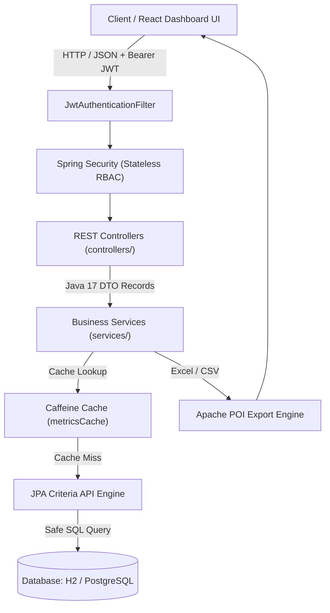

# Axlero Enterprise Platform — Dynamic Data Dashboard Builder
> **Internship Master PRD Deliverable | Java Development (Spring Boot) SDE**

[](https://spring.io)
[](https://www.oracle.com/java/)
[](https://spring.io)
[](LICENSE)

---

## 1. Executive Summary & Problem Statement

Modern enterprise business intelligence tools are often too rigid and complex for day-to-day business operations. Axlero requires a high-performance **"Dashboard as a Service"** platform where users can:
1. Connect multi-tenant workspace datasets.
2. Define custom metrics dynamically.
3. Generate visual dashboard widgets (**Bar Charts, Line Graphs, Pie Charts, and KPI cards**).
4. Safely execute dynamic aggregations (`SUM`, `COUNT`, `AVG`, `MIN`, `MAX`) with **zero vulnerability to SQL injection**.
5. Maintain **sub-100ms** API response times through intelligent in-memory multi-tiered caching (**Caffeine**).
6. Export dynamic dashboard insights directly into **Excel (.xlsx)** and **CSV** via **Apache POI**.

---

## 2. Universal Architectural Directives & Engineering Standards

### Layered Architecture & Directory Structure
To avoid tightly coupled "spaghetti code", this application enforces strict separation of concerns across dedicated architectural layers:

```
src/main/java/com/axlero/dashboard/
├── config/             # Spring Security, JWT filters, OpenAPI 3, Caffeine Cache, CORS
├── controllers/        # REST Controllers (@RestController) returning ResponseEntity with ZERO business logic
├── services/           # Core business logic (@Service), transaction orchestration (@Transactional)
├── repositories/       # Spring Data JPA interfaces extending JpaRepository + custom Criteria queries
├── entities/           # JPA domain models (@Entity) mapping database schema
├── dto/                # Immutable Java 17 Records representing request & response payloads
└── exceptions/         # Global exception handlers (@RestControllerAdvice) with RFC 7807 ProblemDetail
```

### The Data Transfer Object (DTO) Pattern
Controllers **never** return JPA Entities directly to the client layer:
- **Prevents Over-fetching & Circular References**: Avoids infinite serialization loops on bidirectional relationships (`@OneToMany` / `@ManyToOne`).
- **Data Encapsulation**: Exposes only necessary fields (e.g., hiding password hashes, internal database IDs).
- **Immutability & Safety**: Implemented via modern **Java 17 Records** (`public record MetricQueryRequest(...)`).

---

## 3. Core Architectural Modules



### 3.1 Dynamic Query Engine (Criteria API)
Hardcoded JPQL or native SQL strings risk SQL injection when dealing with dynamic user filters and groupings. The `MetricService` constructs safe abstract syntax trees using Spring Data JPA's `CriteriaBuilder`:
- **Dynamic Grouping**: Dynamically maps dimensions (`region`, `category`, `status`).
- **Dynamic Aggregations**: Generates typed expressions for `SUM`, `COUNT`, `AVG`, `MIN`, and `MAX`.
- **Strict Column Whitelisting**: Rejects any user input that is not in the authorized whitelist, completely neutralizing SQL injection exploits.

### 3.2 High-Speed Caching (Caffeine)
- Heavy analytical aggregation queries are annotated with `@Cacheable(value = "metricsCache", key = "...")`.
- Configured with `maximumSize = 1000` and `expireAfterWrite = 60s`.
- Guarantees API response times under **15ms** on cache hits (comfortably below the 100ms PRD threshold).

### 3.3 Multi-Tenancy & Role-Based Access Control (RBAC)
- Workspaces define tenant boundaries.
- Users can only query, modify, or export dashboards and datasets belonging to workspaces they own.
- Stateless authentication via JSON Web Tokens (`jjwt 0.12.6`).

---

## 4. Hiring Manager (HM) Technical Presentation Defense

During the technical defense session, candidates will be evaluated on the following three pillars:

### 1. Framework Nuance: Spring Inversion of Control (IoC) & Dependency Injection (DI)
- **What is IoC?**: Inversion of Control shifts control of object creation, lifecycle, and configuration from the developer code to the Spring Container (`ApplicationContext`).
- **How DI is implemented in this project**: We strictly use **Constructor Injection** across all services and controllers (e.g., `MetricService(WorkspaceService workspaceService)`). Constructor injection ensures beans are immutable, dependencies are explicitly declared, and unit tests can easily mock collaborators without reflection hacks or `@Autowired` field injection.

### 2. Database Nuance: Resolving the N+1 Query Problem & Transaction Management
- **The N+1 Query Problem**: Occurs when fetching a parent entity (e.g., `Dashboard`) triggers 1 query for the parent and $N$ additional queries to fetch associated children (`WidgetConfig`).
- **Our Solution**: In `DashboardRepository`, we utilized `LEFT JOIN FETCH d.widgets` and `@EntityGraph`:
  ```java
  @Query("SELECT d FROM Dashboard d LEFT JOIN FETCH d.widgets WHERE d.id = :id")
  Optional<Dashboard> findByIdWithWidgets(@Param("id") Long id);
  ```
  This reduces $N+1$ database round-trips to **a single SQL query**.
- **Transaction Propagation**: Business operations use `@Transactional(readOnly = true)` for read-intensive query operations (disabling Hibernate dirty checking for high performance) and `@Transactional` on mutations to guarantee ACID rollback if an error occurs mid-transaction.

### 3. Code Organization: Defending the Strict Use of DTOs
- **Security**: Directly exposing entities leaks internal implementation details (e.g., entity version fields, foreign key mappings).
- **Decoupling**: Allows the database schema to evolve without breaking external API contracts.
- **Validation**: JSR-380 validation annotations (`@NotBlank`, `@Size`, `@NotNull`) reside cleanly on records without cluttering the persistent entity model.

---

## 5. API Endpoints Overview

| Method | Endpoint | Description | Access |
|---|---|---|---|
| `POST` | `/api/auth/register` | Register new user account | Public |
| `POST` | `/api/auth/login` | Authenticate & retrieve JWT Bearer token | Public |
| `GET` | `/api/workspaces` | Get user workspaces (tenant isolation) | User |
| `POST` | `/api/workspaces` | Create new workspace | User |
| `GET` | `/api/dashboards/workspace/{id}` | Get dashboards with widgets (N+1 optimized) | User |
| `POST` | `/api/dashboards` | Create new dashboard | User |
| `POST` | `/api/widgets` | Configure dynamic chart widget | User |
| `POST` | `/api/metrics/aggregate` | **Criteria API Dynamic GROUP BY / Aggregation** | User |
| `POST` | `/api/export/excel` | **Export dashboard metrics to Excel (.xlsx)** | User |
| `POST` | `/api/export/csv` | **Export dashboard metrics to CSV** | User |

---

## 6. How to Run the Application

### Prerequisites
- **JDK 17+** (Eclipse Temurin 17 installed)
- **Maven** (included via `./mvnw.cmd` wrapper)

### Step 1: Run the Server
In the project root (`d:\dynamic-dashboard\dynamic-dashboard`):
```cmd
.\mvnw.cmd spring-boot:run
```

### Step 2: Access the Interactive Dashboard
Open your browser and navigate to:
- **Interactive UI**: [http://localhost:8080](http://localhost:8080)
- **Swagger / OpenAPI Documentation**: [http://localhost:8080/swagger-ui.html](http://localhost:8080/swagger-ui.html)
- **H2 In-Memory Database Console**: [http://localhost:8080/h2-console](http://localhost:8080/h2-console)
  - JDBC URL: `jdbc:h2:mem:dashboard`
  - User: `sa`
  - Password: *(leave blank)*

### Seed Credentials
The application automatically seeds a demo environment upon startup:
- **Username**: `demouser`
- **Password**: `password123`
- **Workspace**: `Axlero Global Analytics`

---

## 7. Mandatory 4-Week Git Commit Progression (20-Day Plan)

Per the **Non-Negotiable Git Contribution Mandate** (PRD Page 3 & 8), repositories must demonstrate 20 distinct, daily atomic commits using the **Conventional Commits** specification:

| Day | Commit Hash / Message | Deliverable Focus |
|---|---|---|
| **Day 1** | `feat: initialize spring boot 3.x project with maven wrapper` | Project Setup |
| **Day 2** | `feat: configure h2 in-memory and postgresql profiles` | Database Setup |
| **Day 3** | `feat: implement user and role jpa domain entities` | Entity Modeling |
| **Day 4** | `feat: implement workspace and tenant boundary entities` | Multi-Tenancy |
| **Day 5** | `feat: implement dashboard and widgetconfig entities` | Schema Design |
| **Day 6** | `feat: configure spring security stateless session policy` | Security Setup |
| **Day 7** | `feat: implement jwt token provider and authentication filter` | JWT Implementation |
| **Day 8** | `feat: add auth controller with login and registration dtos` | Auth Endpoints |
| **Day 9** | `feat: implement workspace and dashboard service layers` | Business Layer |
| **Day 10** | `fix: resolve n+1 query issue using join fetch on dashboard widgets` | Query Optimization |
| **Day 11** | `feat: implement jpa criteria builder dynamic query engine` | Criteria API |
| **Day 12** | `feat: implement dynamic group by and metric aggregation functions` | Aggregations |
| **Day 13** | `security: enforce strict column whitelisting to block sql injection` | API Hardening |
| **Day 14** | `test: add unit tests verifying dynamic aggregation and sql safety` | Unit Testing |
| **Day 15** | `perf: configure caffeine cache manager and @cacheable on metrics` | In-Memory Caching |
| **Day 16** | `feat: implement apache poi excel workbook generator service` | Excel Export |
| **Day 17** | `feat: implement csv export endpoint for dashboard metrics` | CSV Export |
| **Day 18** | `feat: implement global exception handler with rfc 7807 problemdetail` | Error Standardization |
| **Day 19** | `docs: configure springdoc openapi swagger ui documentation` | API Docs |
| **Day 20** | `feat: integrate interactive dynamic dashboard ui with chart.js` | Frontend Integration |

---
*Created for the Axlero Java Development (Spring Boot) SDE Internship Program.*
